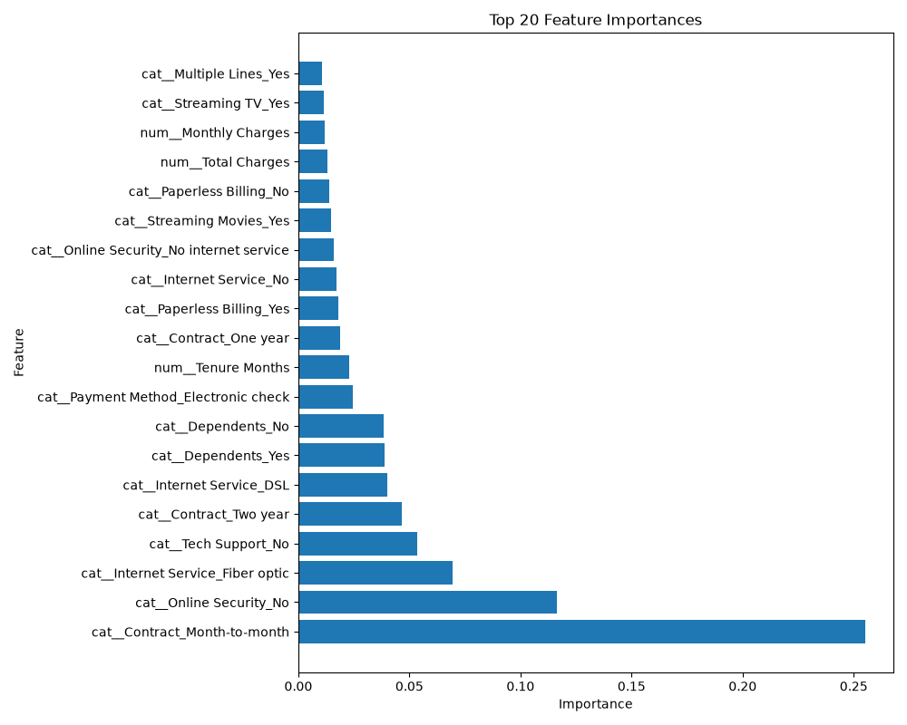
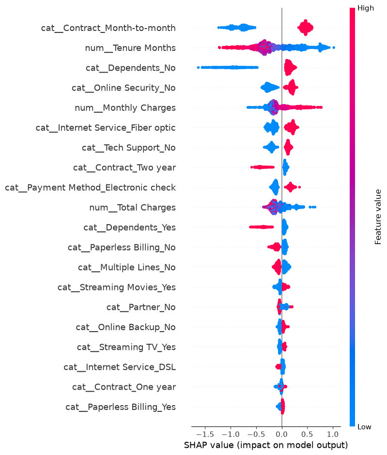

# 🚀 Customer Churn Prediction Platform

An end-to-end Machine Learning system for predicting customer churn using **XGBoost**, optimized through **Optuna**, tracked with **MLflow**, explained using **SHAP**, and deployed through a **FastAPI REST API**.

---

## 📖 Overview

Customer churn is one of the most significant challenges for subscription-based businesses. Retaining existing customers is often far less expensive than acquiring new ones.

This project predicts the likelihood of customer churn and provides actionable business recommendations to support customer retention strategies.

### Key Capabilities

- End-to-end data preprocessing pipeline
- Automated feature engineering
- XGBoost-based churn prediction
- Hyperparameter optimization using Optuna
- Explainable AI using SHAP
- Experiment tracking with MLflow
- REST API deployment using FastAPI
- Production-style project structure

---

## 🎯 Business Objective

The primary objective is to identify customers who are likely to leave the service and assist decision-makers in:

- Reducing customer churn
- Improving retention campaigns
- Increasing customer lifetime value (CLTV)
- Minimizing revenue loss
- Prioritizing high-risk customers

---

## 🏗️ System Architecture

```text
                Telco Customer Dataset
                           │
                           ▼
                 Data Preprocessing
                           │
                           ▼
                Feature Engineering
                           │
                           ▼
          Logistic Regression Baseline
                           │
                           ▼
                  XGBoost Model
                           │
                           ▼
             Optuna Hyperparameter Tuning
                           │
                           ▼
                Best Production Model
                           │
             ┌─────────────┴─────────────┐
             ▼                           ▼
        MLflow Tracking             SHAP Analysis
             │                           │
             └─────────────┬─────────────┘
                           ▼
                    Saved Pipeline
                           │
                           ▼
                       FastAPI
                           │
                           ▼
                    Customer Prediction
```

---

## 🛠️ Tech Stack

| Category | Technology |
|-----------|------------|
| Language | Python |
| Machine Learning | Scikit-Learn, XGBoost |
| Hyperparameter Tuning | Optuna |
| Explainability | SHAP |
| Experiment Tracking | MLflow |
| API Development | FastAPI |
| Data Processing | Pandas, NumPy |
| Visualization | Matplotlib |
| Model Serialization | Joblib |

---

## 📂 Project Structure

```text
customer-churn-platform/
│
├── train.py
├── requirements.txt
├── README.md
│
├── artifacts/
│   ├── best_churn_model.pkl
│   ├── top_features.csv
│   ├── feature_importance.png
│   ├── shap_summary.png
│   └── model_comparison.csv
│
├── data/
│   └── Telco_customer_churn.csv
│
├── mlflow.db
├── mlruns/
│
└── src/
    │
    ├── api/
    │   ├── main.py
    │   ├── schemas.py
    │   └── services.py
    │
    ├── data/
    │   └── load_data.py
    │
    ├── features/
    │   └── preprocessing.py
    │
    ├── models/
    │   ├── train_logistic.py
    │   ├── train_xgboost.py
    │   ├── tune_xgboost.py
    │   └── evaluate.py
    │
    ├── explainability/
    │   ├── feature_importance.py
    │   └── shap_analysis.py
    │
    ├── tracking/
    │   └── mlflow_tracker.py
    │
    └── pipelines/
        └── training_pipeline.py
```

---

## 🔄 Machine Learning Pipeline

### Data Preprocessing

#### Numerical Features

- Tenure Months
- Monthly Charges
- Total Charges

Preprocessing:

```python
SimpleImputer(strategy="median")
StandardScaler()
```

#### Categorical Features

- Contract
- Internet Service
- Payment Method
- Online Security
- Tech Support

Preprocessing:

```python
SimpleImputer(strategy="most_frequent")
OneHotEncoder(handle_unknown="ignore")
```

---

## 🤖 Models Used

### Logistic Regression

Used as a baseline model to establish benchmark performance.

### XGBoost

Selected as the production model because of:

- Superior ROC-AUC performance
- Ability to capture non-linear relationships
- Strong performance on tabular datasets
- Reliable feature importance estimation

---

## ⚡ Hyperparameter Optimization

Hyperparameters were optimized using **Optuna**.

### Optimized Parameters

```python
max_depth
learning_rate
n_estimators
subsample
colsample_bytree
```

### Optimization Objective

```python
ROC-AUC Score
```

### Number of Trials

```python
30
```

---

## 📊 Feature Importance Analysis

The model identified the following features as major drivers of customer churn:

1. Month-to-Month Contract
2. No Online Security
3. Fiber Optic Internet Service
4. No Technical Support
5. Two-Year Contract
6. Dependents
7. Electronic Check Payment
8. Customer Tenure

## 📊 Feature Importance Analysis

The most influential features affecting customer churn are shown below.



### Key Insight

Customers with:

- Month-to-month contracts
- No online security
- No technical support
- Fiber optic internet subscriptions

show significantly higher churn risk.

---

## 🧠 Explainable AI using SHAP

SHAP (SHapley Additive exPlanations) was used to understand how individual features influence model predictions.

## 🧠 Explainable AI with SHAP

SHAP helps explain how individual features influence predictions.



### Key Findings

✅ Month-to-month contracts strongly increase churn probability.

✅ Longer customer tenure decreases churn probability.

✅ Online security significantly reduces churn likelihood.

✅ Higher monthly charges contribute positively to churn risk.

✅ Fiber optic internet service is associated with increased churn.

These insights make the model transparent and business-friendly.

---

## 📈 Experiment Tracking with MLflow

MLflow was used to track:

### Parameters

```python
max_depth
learning_rate
n_estimators
subsample
colsample_bytree
```

### Metrics

```python
accuracy
precision
recall
f1
roc_auc
```

### Artifacts

- Trained Model
- Feature Importance Plot
- SHAP Visualizations

### Launch MLflow

```bash
mlflow ui
```

Open:

```text
http://127.0.0.1:5000
```

---

## 🌐 API Deployment

### Start FastAPI

```bash
uvicorn src.api.main:app --reload
```

### Swagger UI

```text
http://127.0.0.1:8000/docs
```

---

## API Example

### Prediction Request

```json
{
  "Gender": "Male",
  "SeniorCitizen": 0,
  "Partner": "Yes",
  "Dependents": "No",
  "TenureMonths": 5,
  "PhoneService": "Yes",
  "MultipleLines": "No",
  "InternetService": "Fiber optic",
  "OnlineSecurity": "No",
  "OnlineBackup": "No",
  "DeviceProtection": "No",
  "TechSupport": "No",
  "StreamingTV": "Yes",
  "StreamingMovies": "Yes",
  "Contract": "Month-to-month",
  "PaperlessBilling": "Yes",
  "PaymentMethod": "Electronic check",
  "MonthlyCharges": 89.5,
  "TotalCharges": 447.5
}
```

### Prediction Response

```json
{
  "prediction": 1,
  "churn_probability": 0.84,
  "risk_level": "High",
  "recommendation": "Offer 20% discount"
}
```

---

## 📊 Performance

| Model | Accuracy | F1 Score | ROC-------|
| Logistic Regression | 0.79 | 0.57 | 0.71 |
| XGBoost | 0.81 | 0.60 | 0.84 |

### Production Model

✅ XGBoost was selected as the final production model due to its superior ROC-AUC performance.

---

## 💼 Skills Demonstrated

- Machine Learning
- Feature Engineering
- Model Evaluation
- Hyperparameter Tuning
- Explainable AI (XAI)
- Experiment Tracking
- MLOps Fundamentals
- REST API Development
- Production-Ready Project Structure

---

## 🔮 Future Enhancements

- Docker Containerization
- PostgreSQL Integration
- MLflow Model Registry
- GitHub Actions CI/CD
- Cloud Deployment (Azure, AWS, GCP)
- Data Drift Monitoring
- Batch Prediction Pipelines

---

## 👨‍💻 Author

**Ayush Mishra**

Computer Science & Engineering (Artificial Intelligence & Machine Learning)

---

### ⭐ If you found this project interesting, consider giving it a star on GitHub.